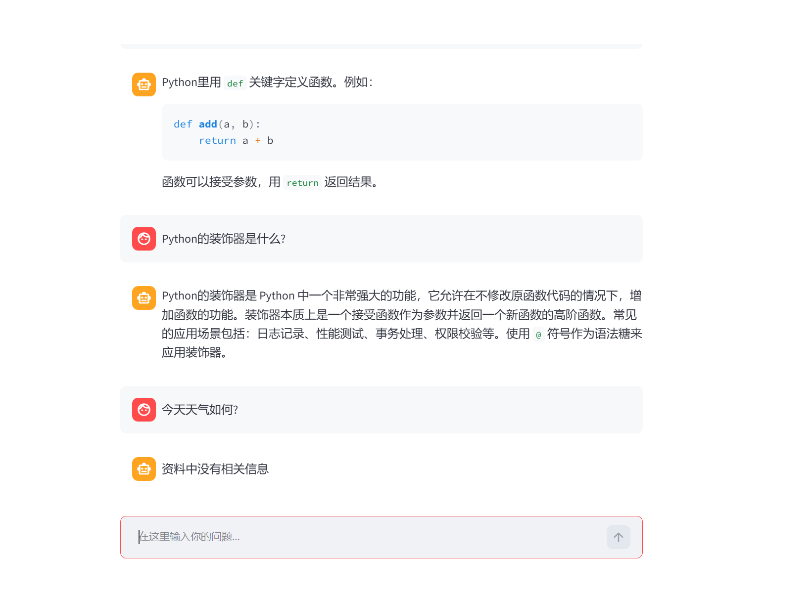

# AI 英语学习助手

## 项目简介
基于通义千问 API 的英语学习工具，输入英文句子，自动返回翻译、语法纠错和更地道的表达建议。支持多轮对话和对话历史持久化。

## 功能
- 英文句子翻译
- 语法错误指出
- 更自然的表达建议
- 多轮对话，保留上下文
- 对话历史持久化（保存到本地 JSON 文件）

## 技术栈
- Python 3
- 通义千问 API（兼容 OpenAI 接口）
- OpenAI Python SDK
- JSON（对话历史持久化）

## 使用方法

### 1. 安装依赖
```bash
pip3 install --user "openai==0.28"
```

## RAG 知识库问答（新增）

基于 RAG 架构的个人知识库问答系统，把 Python 笔记作为知识库，输入问题后自动检索相关内容并生成回答。

### 实现流程
1. 读取 Markdown 文档，按标题切分成小段
2. 用通义千问 Embedding API 把每段转成向量
3. 存入 ChromaDB 向量数据库
4. 用户提问时，检索最相关的 3 段内容
5. 把检索结果 + 问题拼成 Prompt，发给大模型生成回答

### 核心文件
- `rag_step1.py`：读取文档 + 切分
- `rag_step2.py`：向量化 + 存入 ChromaDB
- `rag_step3.py`：检索测试
- `rag_step4.py`：完整 RAG 问答流程
- `python_notes.md`：知识库文档

### 运行方式
```bash
# 第一步：建库（只需运行一次）
python3 rag_step2.py

# 第二步：问答
python3 rag_step4.py
```

## Docker 部署（新增）

本项目已容器化，无需配置本地环境，一键运行。

### 1. 构建镜像
```bash
docker build -t rag-api:v1 .
```

## AI Agent 工具调用（新增）

基于 Function Calling 实现的智能运维 Agent。用户输入问题后，大模型会自动判断是否需要调用本地工具（如查询服务器 CPU/内存），并基于工具返回结果生成回答。

### 核心文件
- `agent_tools.py`：定义了本地工具函数（如 `get_server_status`）
- `agent_demo.py`：Agent 核心逻辑，包括工具说明书定义、大模型调用、本地函数执行和结果二次总结

### 运行方式
```bash
python3 agent_demo.py
```

# AI 智能助手 (RAG + Agent)

## 📺 在线演示 (Demo)



## 项目简介
本项目包含两个核心模块：
1. **企业级 RAG 知识库问答**：结合 Streamlit 前端，通过私有文档检索增强大模型回答，有效解决幻觉问题。
2. **智能运维 Agent**：基于 Function Calling 实现工具调度，Agent 可根据提问自动执行本地 Python 脚本。
...

已接入 MySQL 数据库实现聊天记录持久化